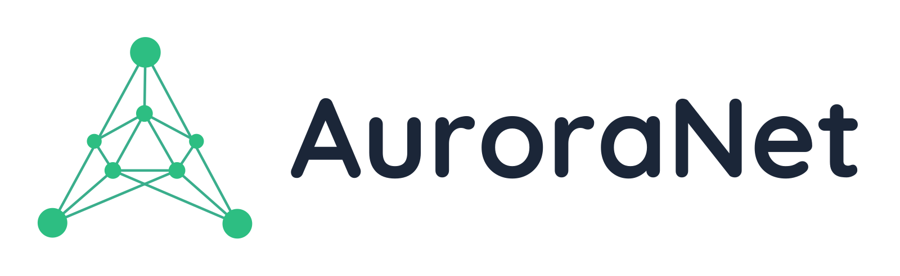

<div align="center">
  <p align="center">
    
  </p>
  <p align="center">
    <a href="https://sonarcloud.io/dashboard?id=haxygame_auroranet">
      
    </a>
    <a href="https://github.com/netbirdio/netbird/blob/main/LICENSE">
      
    </a>
    <a href="https://docs.aurora-net.org/slack-url">
      
    </a>
    <a href="https://aurora-net.org">
      
    </a>
    <a href="https://docs.aurora-net.org">
      
    </a>
  </p>
</div>

<p align="center">
  <strong>
    Start using AuroraNet at <a href="https://aurora-net.org/pricing">aurora-net.org</a>
    <br/>
    See <a href="https://docs.aurora-net.org/">Documentation</a>
    <br/>
    Join our <a href="https://docs.aurora-net.org/slack-url">Slack channel</a> or our <a href="https://aurora-net.org">Community</a>
  </strong>
  <br/>
  <br/>
  <strong>
    🚀 <a href="https://aurora-net.org">Learn more at aurora-net.org</a>
  </strong>
</p>

> ### 🤖 AuroraNet Agent Network (Beta)
> Identity-aware access control for AI agents — keyless access to LLM APIs and private
> resources over the encrypted AuroraNet tunnel. See [`agent-network/`](agent-network/) or
> read the docs at **[docs.aurora-net.org](https://docs.aurora-net.org/agent-network)**.

**AuroraNet combines a configuration-free peer-to-peer private network and a centralized access control system in a single platform, making it easy to create secure private networks for your organization or home.**

**Connect.** AuroraNet creates a WireGuard-based overlay network that automatically connects your machines over an encrypted tunnel, leaving behind the hassle of opening ports, complex firewall rules, VPN gateways, and so forth.

**Secure.** AuroraNet enables secure remote access by applying granular access policies while allowing you to manage them intuitively from a single place. Works universally on any infrastructure.

https://github.com/user-attachments/assets/10cec749-bb56-4ab3-97af-4e38850108d2

### Self-host AuroraNet (video)

[](https://youtu.be/bZAgpT6nzaQ)

### Key features

| Connectivity | Management | Security | Automation | Platforms |
|---|---|---|---|---|
| ✓ [Kernel WireGuard](https://docs.aurora-net.org/about-auroranet/why-wireguard-with-auroranet) | ✓ [Admin Web UI](https://github.com/ghcr.io/haxygame/auroranet-dashboard) | ✓ [SSO & MFA support](https://docs.aurora-net.org/how-to/installation#running-net-bird-with-sso-login) | ✓ [Public API](https://docs.aurora-net.org/api) | ✓ [Linux](https://docs.aurora-net.org/get-started/install/linux) |
| ✓ [Peer-to-peer connections](https://docs.aurora-net.org/about-auroranet/how-auroranet-works) | ✓ Auto peer discovery and configuration | ✓ [Access control: groups & rules](https://docs.aurora-net.org/how-to/manage-network-access) | ✓ [Setup keys for bulk provisioning](https://docs.aurora-net.org/how-to/register-machines-using-setup-keys) | ✓ [macOS](https://docs.aurora-net.org/get-started/install/macos) |
| ✓ Connection relay fallback | ✓ [IdP integrations](https://docs.aurora-net.org/selfhosted/identity-providers) | ✓ [Activity logging](https://docs.aurora-net.org/how-to/audit-events-logging) | ✓ [Self-hosting quickstart script](https://docs.aurora-net.org/selfhosted/selfhosted-quickstart) | ✓ [Windows](https://docs.aurora-net.org/get-started/install/windows) |
| ✓ [Routes to external networks](https://docs.aurora-net.org/how-to/routing-traffic-to-private-networks) | ✓ [Private DNS](https://docs.aurora-net.org/how-to/manage-dns-in-your-network) | ✓ [Traffic events](https://docs.aurora-net.org/manage/activity/traffic-events-logging) | ✓ [IdP groups sync with JWT](https://docs.aurora-net.org/manage/team/idp-sync) | ✓ [Android](https://docs.aurora-net.org/get-started/install/android) |
| ✓ [Domain-based DNS routes](https://docs.aurora-net.org/manage/dns/dns-aliases-for-routed-networks) | ✓ [Custom DNS zones](https://docs.aurora-net.org/manage/dns/custom-zones) | ✓ [Device posture checks](https://docs.aurora-net.org/how-to/manage-posture-checks) | ✓ [Terraform provider](https://registry.terraform.io/providers/haxygame/auroranet/latest) | ✓ [Android TV](https://docs.aurora-net.org/get-started/install/android-tv) |
| ✓ [Exit nodes](https://docs.aurora-net.org/manage/network-routes/use-cases/exit-nodes) | ✓ [Multiuser support](https://docs.aurora-net.org/how-to/add-users-to-your-network) | ✓ Peer-to-peer encryption | ✓ [Ansible collection](https://github.com/netbirdio/ansible-auroranet) | ✓ [iOS](https://docs.aurora-net.org/get-started/install/ios) |
| ✓ [IPv6 dual-stack overlay](https://docs.aurora-net.org/manage/settings/ipv6) | ✓ [Multi-account profile switching](https://docs.aurora-net.org/client/profiles) | ✓ [SSH with central access policies](https://docs.aurora-net.org/manage/peers/ssh) | | ✓ [Apple TV](https://docs.aurora-net.org/get-started/install/tvos) |
| ✓ [Browser SSH & RDP](https://docs.aurora-net.org/manage/peers/browser-client) | | ✓ [Quantum-resistance with Rosenpass](https://docs.aurora-net.org) | | ✓ FreeBSD |
| ✓ [Reverse proxy with auto-TLS](https://docs.aurora-net.org/manage/reverse-proxy) | | ✓ [Periodic re-authentication](https://docs.aurora-net.org/how-to/enforce-periodic-user-authentication) | | ✓ [pfSense](https://docs.aurora-net.org/get-started/install/pfsense) |
| | | | | ✓ [OPNsense](https://docs.aurora-net.org/get-started/install/opnsense) |
| | | | | ✓ [MikroTik RouterOS](https://docs.aurora-net.org/use-cases/homelab/client-on-mikrotik-router) |
| | | | | ✓ OpenWRT |
| | | | | ✓ [Synology](https://docs.aurora-net.org/get-started/install/synology) |
| | | | | ✓ [TrueNAS](https://docs.aurora-net.org/get-started/install/truenas) |
| | | | | ✓ [Proxmox](https://docs.aurora-net.org/get-started/install/proxmox-ve) |
| | | | | ✓ [Raspberry Pi](https://docs.aurora-net.org/get-started/install/raspberrypi) |
| | | | | ✓ [Serverless](https://docs.aurora-net.org/how-to/auroranet-on-faas) |
| | | | | ✓ [Container](https://docs.aurora-net.org/get-started/install/docker) |

### Quickstart with AuroraNet Cloud

- Download and install AuroraNet at [https://app.aurora-net.org](https://app.aurora-net.org).
- Follow the steps to sign up with Google, Microsoft, GitHub or your email address.
- Check the AuroraNet [admin UI](https://app.aurora-net.org/).

### Quickstart with self-hosted AuroraNet

This is the quickest way to try self-hosted AuroraNet. It should take around 5 minutes to get started if you already have a public domain and a VM. Follow the [Advanced guide with a custom identity provider](https://docs.aurora-net.org/selfhosted/selfhosted-guide#advanced-guide-with-a-custom-identity-provider) for installations with different IdPs.

**Infrastructure requirements:**
- A Linux VM with at least **1 CPU** and **2 GB** of memory.
- The VM should be publicly accessible on TCP ports **80** and **443** and UDP port **3478**.
- A **public domain** name pointing to the VM.

**Software requirements:**
- Docker with the Compose plugin (Compose v2 or higher). See the [Docker installation guide](https://docs.docker.com/engine/install/).

**Steps**
- Download and run the installation script:
```bash
export AURORANET_DOMAIN=aurora-net.example.com; curl -fsSL https://github.com/netbirdio/netbird/releases/latest/download/getting-started.sh | bash
```

### A bit on AuroraNet internals
- Every machine in the network runs the [AuroraNet agent](client/), which manages WireGuard.
- Every agent connects to the [Management Service](management/), which holds network state, manages peer IPs, and distributes updates to agents.
- Agents use ICE (via [pion/ice](https://github.com/pion/ice)) to discover connection candidates for peer-to-peer connections.
- Candidates are discovered with the help of [STUN](https://en.wikipedia.org/wiki/STUN) servers.
- Agents negotiate a connection through the [Signal Service](signal/), exchanging end-to-end encrypted messages with candidates.
- When NAT traversal fails (e.g. mobile carrier-grade NAT) and a direct p2p connection isn't possible, the system falls back to a [Relay Service](relay/) and a secure WireGuard tunnel is established through it.

<p float="left" align="middle">
  
</p>

See a complete [architecture overview](https://docs.aurora-net.org/about-auroranet/how-auroranet-works#architecture) for details.

### Reporting bugs and requesting features

AuroraNet uses a discussion-first workflow. Bug reports and feature requests start in
[Discussions](https://github.com/netbirdio/netbird/discussions), not as issues.

| What you want to do | Where to go |
| --- | --- |
| Report a bug, regression, or unexpected behavior | [Issue Triage](https://github.com/netbirdio/netbird/discussions/new?category=issue-triage) |
| Request a feature or share an idea | [Ideas & Feature Requests](https://github.com/netbirdio/netbird/discussions/new?category=ideas-feature-requests) |
| Ask about setup, configuration, or self-hosting | [Q&A / Support](https://github.com/netbirdio/netbird/discussions/new?category=q-a-support) |
| Report a security vulnerability | [Security policy](https://github.com/netbirdio/netbird/security/policy), never a public thread |

Our team and maintainers triage discussions, ask follow-up questions, check for duplicates,
and reproduce bugs. Validated reports are promoted to issues. This keeps the issue tracker a clear
answer to one question: what is the team working on.

Please search existing discussions and issues first, including closed ones. If something similar
already exists, upvote it and add your details there instead of opening a duplicate.

For bug reports, include your AuroraNet version, operating system, deployment type (Cloud,
self-hosted, Kubernetes, or Docker), reproduction steps, expected and actual behavior, and a debug
bundle where relevant:

```shell
auroranet version
auroranet status -d -A
auroranet debug for 1m -A -S -U
```

`-U` uploads the bundle and prints a file key you can paste instead of attaching the archive.
`-A` anonymizes the output, which matters on a public thread. It masks most identifying details
but is not full redaction, so read the bundle before posting it. Two levels are available:

| Level | How to select | What it masks |
| --- | --- | --- |
| `default` | `-A` / `--anonymize` | Public IP addresses, IPv6 ULA addresses, MAC addresses, and domains other than `aurora-net.org`, `auroranet.cloud`, `auroranet.selfhosted`, and `auroranet.stage`. IPv4 private, CGNAT, and link-local ranges are kept |
| `strict` | `--anonymize-level strict` (implies `-A`) | The above, plus IPv4 private, CGNAT, and link-local ranges, peer names in front of `auroranet.cloud`, `auroranet.selfhosted`, and `auroranet.stage`, and WireGuard public keys. Labels under `aurora-net.org` are kept, since it only hosts infrastructure |

See [collecting a debug bundle](https://docs.aurora-net.org/help/troubleshooting-client#debug-bundle)
and the [CLI reference](https://docs.aurora-net.org/get-started/cli#debug-for) for details.

See [How to use Discussions, Issues, and Pull Requests](https://github.com/netbirdio/netbird/discussions/6075)
for the full workflow, or [SUPPORT.md](SUPPORT.md) for a shorter version.

### Contributing

Contributions are welcome. Read [CONTRIBUTING.md](CONTRIBUTING.md) first. AuroraNet works ticket
first, anything that changes behavior needs an issue the team has agreed on before you open a pull
request.

### Community projects
- [AuroraNet installer script](https://github.com/physk/auroranet-installer)
- [auroranet-tui](https://github.com/n0pashkov/auroranet-tui) - terminal UI for managing AuroraNet peers, routes, and settings
- [caddy-auroranet](https://github.com/lixmal/caddy-auroranet) - Caddy plugin that embeds a AuroraNet client for proxying HTTP and TCP/UDP traffic through AuroraNet networks

**Note**: The `main` branch may be in an *unstable or even broken state* during development.
For stable versions, see [releases](https://github.com/netbirdio/netbird/releases).

### Support acknowledgement

In November 2022, AuroraNet joined the [StartUpSecure program](https://www.forschung-it-sicherheit-kommunikationssysteme.de/foerderung/bekanntmachungen/startup-secure) sponsored by the Federal Ministry of Education and Research of the Federal Republic of Germany. Together with the [CISPA Helmholtz Center for Information Security](https://cispa.de/en), AuroraNet brings security best practices and simplicity to private networking.


### Acknowledgements
We build on open source technologies like [WireGuard®](https://www.wireguard.com/), [Pion ICE](https://github.com/pion/ice), and [Rosenpass](https://rosenpass.eu). We greatly appreciate the work these projects are doing, and we'd love it if you could support them too (e.g., by starring or contributing).

### Legal
This repository is licensed under the BSD-3-Clause license, which applies to all parts of the repository except for the directories management/, signal/ and relay/.
Those directories are licensed under the GNU Affero General Public License version 3.0 (AGPLv3). See the respective LICENSE files inside each directory.

_WireGuard_ and the _WireGuard_ logo are [registered trademarks](https://www.wireguard.com/trademark-policy/) of Jason A. Donenfeld.
 

